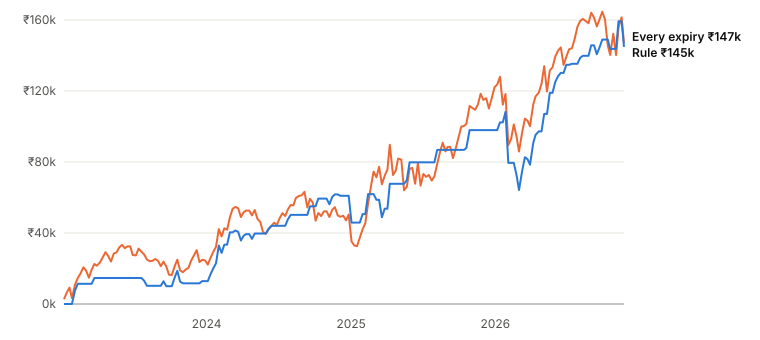
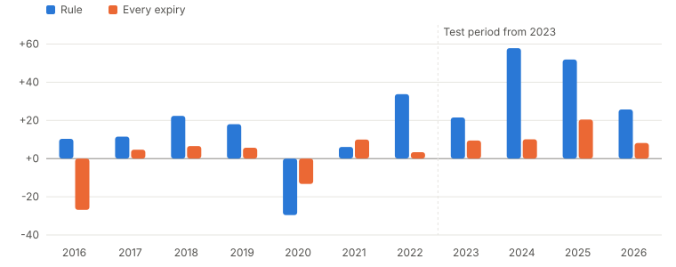

# Rich premium expiry straddle

Sell the at-the-money Nifty straddle at the close the day before expiry, only when its premium is rich against the move India VIX implies, and hold it to the expiry settlement.
Research and paper trading only; nothing here places orders.

Full report with stats and explanation: [`report.html`](report.html) (download and open in a browser).

## Result

On Nifty from January 2023 to November 2026, a period the rule was not chosen on, it made **+39.6 points a trade after costs** (95% range +13.7 to +64.0, 77 trades, 71% winners).
Selling every expiry made +12.2 a trade over 204 expiries.
Both end near ₹1.45 lakh a lot, so the rule earns the same money with about a third of the trades and tail exposure.





| Sample                            | Trades | Points a trade | 95% range       | At 2x cost | Every expiry |
| --------------------------------- | -----: | -------------: | --------------- | ---------: | -----------: |
| Nifty 2023 to Nov 2026 (test)     |     77 |          +39.6 | +13.7 to +64.0  |      +35.4 |        +12.2 |
| Nifty after April 2026 tax rise   |     19 |          +53.7 | +7.2 to +98.0   |      +49.4 |        +21.2 |
| Nifty Jul 2021 to 2022 (choosing) |     38 |          +19.8 | -13.6 to +51.0  |      +15.7 |         +0.4 |
| Nifty Feb 2019 to Jun 2021 (fit)  |     39 |            0.0 | -49.0 to +40.6  |       -4.1 |         +2.7 |
| Sensex 2024 to Nov 2026           |     38 |          +86.9 | -64.3 to +230.8 |      +82.0 |        +49.9 |
| Bank Nifty Jun 2016 to Nov 2024   |    150 |          +41.0 | -14.4 to +92.7  |      +36.8 |        +30.3 |

## The rule (frozen)

1. At the close of the trading day before each weekly expiry, take the strike nearest the index close where both the call and the put traded.
2. ratio = (call + put) / (spot × VIX/100 × √(1/252)).
3. Sell the straddle only if the ratio is above the 67th percentile of the previous 52 expiries.
4. Hold to expiry: profit = premium - |settlement - strike|.
5. Cost: 4 points a straddle plus option-sale STT at the day's rate (0.15% of premium from April 2026).

Fills are the NSE closing price (last-30-minute VWAP), not bid and ask quotes.

## Risks

- Flat on Nifty from 2019 to mid-2021; the edge may belong to the current market.
- About 2,975 ideas were tried in the wider search; t = 3.07 is below the ~4.1 that rules out luck at that count.
- No stop or wings: 12 March 2020 cost 692 points (₹51.9k a lot); the worst test trade was -₹28.8k.

## Commands

```bash
uv run --extra rich-premium jev-shadow rich-premium fetch      # free NSE/BSE daily F&O files, India VIX, index closes
uv run --extra rich-premium jev-shadow rich-premium build      # daily options panels (parquet)
uv run --extra rich-premium jev-shadow rich-premium backtest   # cycle tables and per-split stats
uv run --extra rich-premium jev-shadow rich-premium track      # forward paper tracker, append-only ledger
```

Downloads go to `data/raw/nse-daily` and outputs to `data/output/rich_premium/`, both gitignored.

## Forward paper test

The tracker records each decision before the expiry settles, for Nifty and Sensex.
It reviews after 40 rule trades: pass if t ≥ 2 and it beats selling every expiry; stop early if losses pass three times the median premium.
First trade: Sensex expiry 26 Nov 2026, sold the 83,900 straddle for 793.25, settled +359.5 points (+₹7,189 a lot).
